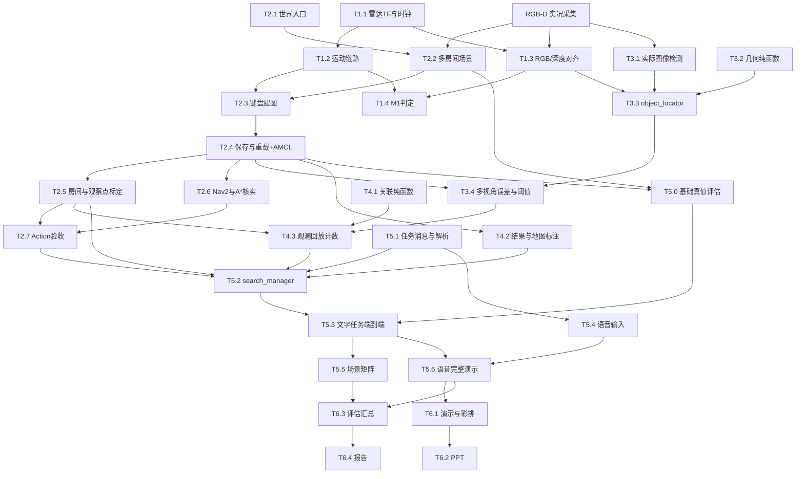

# 任务四开发与验收路线

规划基准日为 2026-11-20。本文给出依赖、任务卡和通过条件，阶段编号沿用 M0—M6。算法原理、GitHub 调研和备选方案见 [任务四技术路线](技术路线.md)。项目完成情况以 [状态与运行证据](../PROJECT_STATUS.md) 为准。

标记约定：

- 状态：【实测】有实际运行记录；【待验收】代码或配置已存在、未运行验收；【草案】只有文档约定；【待核实】版本、命令、话题或文件未经本机确认；【未开始】。
- 来源：〔任务书〕教师明文要求；〔教程〕教师教程中的做法，仅供参考；〔工程〕本项目工程方案；〔待确认〕需要教师或组内决定。
- 实际引入第三方源码、模型或依赖前，确认授权并记录来源、固定版本、许可和 SHA-256。

---

## 0. 资料核对

### 0.1 路线依据

| 资料 | 读取方式 | 用途 |
| --- | --- | --- |
| 项目总目录与工作区 `AGENTS.md`、`PROJECT_STATUS.md`、`docs/学习进度.md`、`docs/学习现状与算法实施安排.md` | 全文 | 当前基线与约定 |
| `.agents/skills/task4-delivery/SKILL.md` 及 `references/milestones.md`、`ros2-integration.md`、`counting-and-results.md` | 全文 | 阶段证据标准、排错与计数方法 |
| `materials/original/设计任务及要求2026.docx` | 解析 `word/document.xml` 文本 | 通用要求、基础工作、任务四原文 |
| `materials/original/设计报告样本--项目最终报告模板.doc` | LibreOffice 文本导出 | 报告章节结构 |
| `materials/original/codex-clipboard-…png`（课程群通知截图） | 查看图片 | 教师说明：教程“供大家参考”，第 10 周周五展示 |
| `materials/tutorials/设计教程.pdf`、`设计教程2.pdf`、`设计教程3.pdf` | `pdftotext` 文本（图片内容不可见） | TB3/Gazebo Classic、SLAM Toolbox、Nav2、yolo_ros、语音示例 |
| `README.md`、`docs/任务要求与验收.md`、`docs/技术路线.md`、`docs/架构与接口.md`、`docs/第一步_仿真与传感器验收.md`、`docs/实施路线.md` | 全文 | 既有路线与接口草案 |
| `WORKLOG.md`、`env.sh`、`sim_env.sh`、`start_sim.sh`、`build.sh`、`scripts/*.py`、`src/task4_bringup/**`、`results/**` 目录与关键 JSON | 全文或抽查 | 实际入口、配置与证据 |
| GitHub 上游仓库、分支和官方文档 | 2026-11-20 在线复核 | [组件、语义导航案例和备选方案](技术路线.md#github-调研与可行替代方案) |

### 0.2 最新记录校正

- 截至 2026-11-22，**M0—M4 已完成，M5 已达成文字整链 G2**。下一项是 T5.4 中文语音输入，随后做 T5.6 真实语音整链。最新证据和复现入口见 [交接文档](交接文档.md)，以下安排以 11-27 展示为目标。
- `results/m1_sensor_check/agent-topic-probe-2026-11-08.txt` 记录了受限执行环境中 `getifaddrs: Operation not permitted`、DDS 传输创建失败、只看到 `/parameter_events` 和 `/rosout`。Codex 在沙箱中运行 ROS 命令可能看不到仿真图，需要按其权限流程申请提权运行只读命令，或由用户代跑并粘贴输出。
- 本机静态核对确认 `turtlebot4_ignition_bringup` 的 `ignition.launch.py` 会覆盖 `IGN_GAZEBO_RESOURCE_PATH`。`turtlebot4_spawn.launch.py` 已声明 `rplidar_stf`。独立的 `turtlebot4_navigation/launch/nav2.launch.py` 默认使用 TB4 的 `config/nav2.yaml`，其中 NavFn 的 `use_astar: false`。上述发现作为任务卡的排查依据，实时发布者与参数仍需采证。

### 0.3 待确认事项及影响

| 缺失项 | 影响 | 处理 |
| --- | --- | --- |
| ROS 图、在线 TF、仿真 Action 服务 | 本机可读到 `teleop_twist_keyboard`、`nav2_simple_commander`、`message_filters` 及 Undock 的安装文件，实际话题、发布者与 Action 服务有待运行确认 | 使用本工作区环境实际采样；通过条件以运行输出为依据 |
| 教程 PDF 中的截图 | 只能依据文字部分 | 以文字为准，截图内容不作引用 |
| 教师对平台型号、评分权重、遮挡范围的说明 | 平台适配边界不确定 | 列为决策 D1，按标准接口推进 |
| 组员姓名与学号 | 分工表只能用 A/B/C | 列为决策 D4 |

---

## 1. 需求与基线

### 1.1 任务书关键原文

以下摘自 `设计任务及要求2026.docx`（按文档段落顺序标注）：

- 通用要求：“3人一组……注意分工合作。”“请各组同学制作ppt，可以包括系统功能概述（设计成果展示）、基本原理、设计实现方法、可能存在问题及后续改进提高等内容。”“2026.12.6日之前提交设计报告（电子版），每组提交一份，报告中明确分工和各自的贡献。”展示时间为“2026.11.27日周五上午3-4节”与“下午8-9节”。
- 基础工作：“使用已有的turtlebot2模型……通过修改urdf模型文件加入所需传感器（摄像头等）……在gazebo中搭建任务环境（多个房间，可以添加不同的家具摆设）”。
- 任务四“物体搜寻机器人-扩展”，实现目标：“通过语音向仿真模型发出控制指令，到指定房间统计某种物品的总数，并在构建的环境地图中标注出物品所在位置。”
  1. “通过键盘控制机器人在环境中运动……构建一幅环境地图并保存，通过坐标对地图中不同的房间进行命名：客厅，厨房，卧室。”
  2. “通过调用百度AI、科大讯飞等提出的自然语言处理技术识别语音指令并提取其中的地点，物品等关键词信息，并发布一条包含关键词的message。”
  3. “机器人订阅message后，获取关键词信息，利用A*等算法对路径进行规划从而运行至指定房间。”
  4. “到达指定房间后，可通过原地旋转或沿房间边缘运动的方式对房间中的物品进行扫描并识别。”
  5. “对找到的指定物品进行编号，记录其所在位置坐标，并在构建的环境地图中对每一个物品所在位置进行标记。”
  6. “遍历完指定房间后，在终端中打印指定房间中所含指定物品的总数，并保存一幅带有物品标记的环境地图。”

报告模板章节：1 简介；2 系统实现（2.1 总体设计与架构，2.2 任务分配，2.3 实现过程）；3 系统测试和评估；4 可能存在问题及后续改进提高。

### 1.2 课程要求 → 阶段 → 验收证据

表中状态记录初期基线。逐项最新状态见 [任务四要求与验收](任务要求与验收.md#工程验收建议)。

| # | 课程要求〔任务书〕 | 阶段/任务 | 验收证据（计划保存位置） | 初期状态与依据 |
| --- | --- | --- | --- | --- |
| R1 | 键盘控制建图并保存 | M2：T2.3、T2.4 | `maps/task4_home_v1.{pgm,yaml}`、重新加载日志、RViz 截图，`results/m2_map_nav/` | 【未开始】`maps/README.md`：“当前无地图” |
| R2 | 用坐标命名客厅、厨房、卧室 | M2：T2.5 | `config/rooms.yaml`（`calibrated: true`）、房间叠加图 | 【草案】`rooms.example.yaml` 为 `calibrated: false`、坐标为空 |
| R3 | 语音识别并提取地点、物品 | M5：T5.1、T5.4 | 录音 wav、ASR 文本、解析 JSON | 【未开始】`frames_topics.yaml`：`voice_provider: null` |
| R4 | 发布包含关键词的 message | M5：T5.1 | `/task4/task` 的 echo 记录 | 【未开始】接口仅在《架构与接口》中为草案 |
| R5 | 订阅 message，用 A* 等算法规划到指定房间 | M2：T2.6、T2.7；M5：T5.2 | 运行时 `use_astar` 参数读取、Action 终态 JSON | 【部分实测】A* 三房间入口和异常终态已验收，任务消息接入待做 |
| R6 | 原地旋转或沿边扫描并识别 | M3：T3.1、T3.3；M5：T5.2 | 观察点执行记录、检测样例图 | 【部分实测】两轮实际相机帧验证了场景椅子的颜色检测，在线扫描待接入 |
| R7 | 编号并记录物品坐标 | M3：T3.4；M4：T4.1 | 多视角误差表、`inventory.json` | 【未开始】 |
| R8 | 在地图中标记每个物品 | M4：T4.2 | `map_annotated.png` | 【未开始】 |
| R9 | 遍历后终端打印总数 | M5：T5.2、T5.3 | 终端日志 | 【未开始】 |
| R10 | 保存带物品标记的地图 | M5：T5.3、T5.6 | 重新打开后的核对记录 | 【未开始】 |
| R11 | 基础工作：TurtleBot2，URDF 加传感器 | 平台：D1、M1 | 平台说明、传感器验收 | 【待确认】当前用 TB4 Lite 自带 RGB-D 与雷达，相机/里程计/激光接收为【实测】 |
| R12 | 基础工作：Gazebo 多房间带家具 | M2：T2.1、T2.2 | `worlds/task4_home.sdf`、截图 | 【未开始】`worlds/README.md`：“当前尚未选择或创建场景” |
| R13 | 3 人分工，报告明确贡献 | M6：T6.4 | 分工表、WORKLOG 署名 | 【待确认】PROJECT_STATUS“组员姓名和具体分工”待决定 |
| R14 | 11-27 展示，制作 PPT | M6：T6.1、T6.2 | PPT、演示视频 | 【未开始】 |
| R15 | 12-06 前提交电子报告 | M6：T6.4 | 报告文件 | 【未开始】模板结构已读取 |

### 1.3 M1 现有证据逐项校正

以下保留 M1 的初期取证情况。最终验收见 [T1.4 M1 总验收](交接文档.md#t14-m1-总验收)。

| 检查项 | 状态 | 依据 |
| --- | --- | --- |
| 仿真启动、RGB 画面 | 【实测】 | `results/m1_sensor_check/user-rgb-view-2026-11-08.png` |
| RGB/深度/CameraInfo 接收 | 【实测】 | `agent-rgbd-report-2026-11-08.json`、`user-rgbd-report-2026-11-08.json`：320×240，rgb8/32FC1，frame `oakd_rgb_camera_optical_frame`，fx≈221.765、cx=160、cy=120 |
| base_link→相机 TF | 【实测】（静止时单次） | `user-camera-tf-2026-11-09.png`：T=[-0.037, 0, 0.186] m，q(xyzw)=[-0.5, 0.5, -0.5, 0.5] |
| /odom 与 odom→base_link | 【实测】（静止） | `user-odom-evidence-2026-11-09.json` |
| /scan 接收与元信息 | 【实测】 | `user-laserscan-2026-11-09.png`：frame `turtlebot4/rplidar_link/rplidar`，640 点，约 57 Hz；`lesson02_scan_reader/2026-11-09/live-scan-reader.log` |
| base_link→雷达 TF | 【未验证】 | 无查询记录。注意雷达 frame 带 Gazebo 作用域前缀，需查实际 TF 树 |
| /clock 与 use_sim_time | 【未验证】 | 仅桥接静态配置包含 /clock |
| 运动前后变化 | 【未验证】 | odom 仅有静止截图，twist 未完整显示 |
| RGB/深度几何对齐 | 【未验证】 | `frames_topics.yaml`：`rgb_depth_aligned: null`；同尺寸/同 frame/同时间戳不能证明对齐 |

结论：M1 剩余三项（雷达 TF、时钟、运动）阻塞 SLAM；几何对齐只阻塞三维物品定位。

### 1.4 平台差异与适配边界

| 维度 | TurtleBot2〔任务书〕 | TurtleBot3〔教程〕 | TurtleBot4 Lite（当前开发平台） |
| --- | --- | --- | --- |
| 底盘与传感器 | Kobuki 底盘，需自行在 URDF 加摄像头等 | `burger_cam`/`waffle_pi`，教程把 camera 的 sensor type 改为 depth | Create3 底盘，自带 RPLIDAR 与 OAK-D 相机 |
| 仿真器 | 任务书链接指向 ROS1 wiki 与 Gazebo Classic 教程 | Gazebo Classic + `gazebo_ros`，`turtlebot3_gazebo` | Ignition Fortress + ros_gz 桥接 |
| 本机状态 | Humble 下的 TB2 仿真包【待核实】 | 未见 `turtlebot3_gazebo`、`gazebo_ros`（PROJECT_STATUS） | 已有 `turtlebot4_simulator` 0ea4a60，已实测传感器 |
| 话题与 frame | 【待核实】 | `/camera/image_raw`、`/camera/depth/image_raw`（教程 3） | `/oakd/rgb/preview/*`、`/scan`，雷达 frame 带 `turtlebot4/` 前缀 |
| 特有流程 | — | 设置 `TURTLEBOT3_MODEL` | 机器人在充电座上生成，移动前需 undock【待核实】 |

教师确认前可以推进的工作（与底盘无关或只依赖标准接口）：语音采集/识别/解析、任务消息、物品关联与编号、结果保存与地图标注、搜索状态机、评估脚本、场景中的家具与物品布置（模型可复用，世界插件需适配）、全部纯 Python 单元测试，以及在 TB4 上完成的整机流程。所有话题名、frame 名和机器人参数集中在 `config/task4_params.yaml`，避免写死。

若教师确认必须使用 TurtleBot2，需要重新适配并重新验收的边界：

1. 机器人描述：TB2 URDF/xacro，加入深度相机与激光插件（Classic 插件），重新验收 M1 全部项目（话题、编码、内参、TF、时钟、运动、对齐）。
2. 仿真器与世界：如改用 Gazebo Classic，世界文件中的系统插件、光照和模型引用需改写；房间几何与家具可沿用。
3. 导航与建图参数：足迹半径、速度/加速度限制、控制器参数、SLAM 参数按 TB2 重配；重新建图、重新标定房间与观察点（M2 全部重做）。
4. 感知：重新采集图像做检测可行性（相机外观/分辨率变化），重新做多视角误差与关联阈值（T3.1、T3.4）。
5. 不需要改动：`task_parser`、`association`、`result_io`、`map_annotate`、状态判定函数及其测试；只需改配置。
6. 工期影响：TB2 适配会重新进入 M1，难以纳入 11-27 的 TB4 联调日程。建议 11-21 前向教师说明当前 TB4 Lite/Fortress 平台及已实测的传感器接收情况，确认是否接受替代方案。若要求 TB2，询问课程可用的模型、插件与环境，再评估迁移。

### 1.5 待决定事项

| 编号 | 决定 | 决定人 | 最晚时间 | 未决定时的默认做法 |
| --- | --- | --- | --- | --- |
| D1 | 是否认可 TB4 替代 TB2 | 教师 | 11-21 | 继续用 TB4，展示时说明 |
| D2 | 在仿真中通过可行性检查的目标类别（候选 `chair`、`bottle`、`cup`） | 组内（B 主导） | 11-21 晚，依据 T3.1 | 先试椅子，通过后冻结类别及模型 |
| D3 | 百度短语音或经实测的离线中文 ASR | 组内（C 主导） | 11-22 | 先验证百度凭据和网络，失败时试 Vosk；文字入口用于联调 |
| D4 | 组员姓名、学号与 A/B/C 角色 | 组内 | 11-21 | 按 A/B/C 记录 |
| D5 | 授权联网安装：ultralytics/权重、Fuel 模型、语音 SDK 或模型 | 用户 | 用到前 | 不安装，使用备选方案 |
| D6 | 是否在 11-25 晚冻结功能 | 组内 | 11-22 | 冻结 |

---

## 2. M0—M6 执行顺序

### 2.1 依赖图



整链有三条汇合支线。建图导航线从雷达、时钟、运动和项目世界汇合到 T2.3，再交付地图、房间和 Action 验收；感知线可提前用 maze 里的实体目标试检测，完成对齐后先验证 odom 定位，再等地图定位完成多视角回放；业务线可先做离线关联、合成地图标注、关键词解析和麦克风预检。真实报表和整链验收等待实测地图、观测和基础真值评估。地图或观测数据未就绪时，继续可独立完成的部分。

### 2.2 倒排日程

| 日期 | A：仿真、建图、导航 | B：检测与地图定位 | C：语音、任务、计数、结果 | 交接/检查点 |
| --- | --- | --- | --- | --- |
| 11-20 五 晚 | T1.1；本地 launch 核对 | 基础画面采集、T3.2 离线几何 | T5.4 麦克风与单句 ASR 预检；T4.1 离线关联 | 确认 D1、D3、D5 的进展 |
| 11-21 六 | T1.2；T2.1 最小世界通过后制作三房间 | T3.1 实况单类检测；T1.3 对齐 | T5.1；T4.2 合成地图测试 | D2 冻结可识别实体；D4 分工 |
| 11-22 日 | T2.3—T2.7，先验一个入口；完成三房间标定 | T3.3 先用 odom | T5.2 离线流程；T5.4 接解析发布 | H2、首个入口实测；**G1** |
| 11-23 一 | 配合多视角取样、补入口与失败测试 | T3.4 地图定位 | T4.3 真实回放；T5.0 基础评估；T5.2 接入导航 | H4；就绪后开始联调 |
| 11-24 二 | 联调与演示启动 | 修正影响计数的感知问题 | T5.3 已知非零和空房 | **G2** |
| 11-25 三 | 补其余房间入口验证 | 复测关键场景 | T5.6 真实语音整链；有余量再跑失败与取消 | **G3**；按通过结果冻结 |
| 11-26 四 | T6.1 彩排，录备份视频 | 汇总已有评估 | T6.2 PPT | 预留复演和修复时间 |
| 11-27 五 | 课程展示 | | | |
| 11-28—12-04 | 补齐 T5.5 场景矩阵 | 定位误差分析 | 计数误差分析 | T6.3、T6.4 |
| 12-05 | 报告定稿提交（留 1 天余量） | | | 截止 12-06 |

### 2.3 阶段通过条件

| 阶段 | 通过条件 |
| --- | --- |
| M1 | T1.1、T1.2 通过可解锁 SLAM；T1.3 的相机几何检查通过可开始三维定位；T1.4 写入 `frames_topics.yaml` 并给出 M1 结论 |
| M2 | 地图保存并重新加载；AMCL 定位有效；`rooms.yaml` 标定且通过检查；运行时核实 NavFn A*；三房间入口成功，失败、取消、超时分别记录终态与原因 |
| M3 | 实际仿真图像中目标类别可检测；同一物品至少 3 个观察位置的地图坐标，误差表与阈值写入配置 |
| M4 | 关联单元测试覆盖所列边界；真实观测回放下重访不新增编号；结果文件重新打开一致 |
| M5 | 一次真实中文语音触发的完整 task_id 链路；状态、总数、清单、标注一致；非零、空房与重访得到实测验证。完整 S0—S9 场景矩阵归入 M6 评估 |
| M6 | 演示脚本、视频、PPT、报告中的每个结论都能对应 `results/` 下的实验目录 |

### 2.4 检查点与降级演示

| 检查点 | 达到的标准 | 未达到时 11-27 能如实演示的内容 | 仍缺的课程要求 |
| --- | --- | --- | --- |
| G1（11-22 晚） | 三房间地图已保存并重载，房间已标定，至少一个入口成功到达 | 展示实际完成的场景、键盘建图或传感器证据 | 其余入口与完整 M2 继续验收；语音及搜索仍待联调 |
| G2（11-24 晚） | 一次已知非零的文字整链，计数与真值一致；一次空房完成；有重访去重证据 | 展示已验证的导航和实时检测，再展示录制观测的回放与标注 | 在未通过的场景中，R7—R10 仍需在线验证 |
| G3（11-25 晚） | 一次真实中文语音触发非零整链，录音、任务、清单与标注能通过同一 task_id 核对 | 已通过的文字整链加单独实测的语音识别与解析 | R3 的语音整链联动仍待通过 |
| 冻结后 | 只修阻塞演示的缺陷 | — | — |

可延期的增强项包括沿房间边缘运动的搜索、RViz 实时 MarkerArray、多类别同时统计、语音取消、自定义 ROS 消息包、移动物体、自动探索建图和提高相机分辨率。平台迁移是否需要执行由 D1 决定。

### 2.5 分工与交接

- A（仿真/建图/导航）：适合需要大量 GUI 与键盘操作的用户本人或熟悉 RViz 的组员。
- B（检测/定位）：需要能安装与调试 Python 依赖。
- C（语音/任务/计数/结果）：纯 Python 工作最多，可最早开始离线开发。
- 当前用户一人推进，A/B/C 用于划分工作模块。交接证据随 [交接文档](交接文档.md) 更新。H1 为 M1 汇总与 frame 表，H2 为地图和房间配置，H3 为导航启动与 Action 实测，H4 为观测样例和关联门限。
- 协作方式（共享仓库、分支或拷贝合并）【待确认】。所有代码最终合入本工作区，WORKLOG 每条注明执行人。

### 2.6 学习安排

当前学习检查点停在 02C5（角度与雷达平面坐标，理解待反馈）。工期只剩 7 天，建议把剩余学习改为每个阶段附带的“最小理解任务”（见各任务卡），学习深度按本人在 A/B/C 中的角色取舍；理论课补讲放到 11-28 之后的报告期。是否这样调整由用户决定，`docs/学习进度.md` 按实际反馈记录。

---

## 3. 任务卡

### 3.0 所有任务共用的约定

- 工作目录：`/home/hao/Documents/ChatGPT/自主移动机器人综合设计大项目/task4_ws`（下文简称 `task4_ws`）。
- 环境：仿真相关终端执行 `source sim_env.sh`；纯包构建或离线测试执行 `source env.sh`。新增或修改入口、依赖后执行 `bash build.sh` 并重新 `source sim_env.sh`。
- 仿真：终端 A 由用户执行 `bash start_sim.sh`（T2.2 三房间场景可用 `TASK4_WORLD=task4_home bash start_sim.sh`），保持运行，结束时在该终端按 Ctrl+C。
- 会等待 ROS 消息、服务或持续输出的命令加外层限时。使用 `tee` 保存时立即记录原命令的 `${PIPESTATUS[0]}`；持续采样中的 124 表示到达时限，是否通过再根据实际样本判定。
- 证据目录：`results/<主题>/<YYYY-MM-DD>_<任务号>/`，不覆盖旧目录。其中写 `commands.txt`（命令、执行目录、退出码）和 `summary.json`（结论、通过项、失败项、证据文件列表）。用户截图或代跑输出注明来源与 SHA-256。
- 每项完成后：更新 `PROJECT_STATUS.md`，向 `WORKLOG.md` 追加日期、执行人、变更、实际检查、证据路径、下一步；涉及学习时更新 `docs/学习进度.md`。
- 若 ROS 命令报 `getifaddrs: Operation not permitted` 或只看到 `/rosout`、`/parameter_events`：不要修改 DDS/RMW 配置，按 Codex 权限流程申请提权运行该只读命令；仍不可用时把命令交给用户运行，粘贴结果保存为 `user-*.txt`。
- 按 D5 核对所需依赖、源码和模型的引入授权，保存固定版本与来源。优先复用本机已安装组件。

---

### M1 收尾

#### T1.1 雷达 TF、/clock 与仿真时间（首轮）

- **目标**：用实际 `/scan` 消息头取得雷达 frame，验证 `base_link` 到该 frame 的 TF；确认 `/clock` 有发布、关键节点使用仿真时间、传感器时间戳为仿真时间。只读，不运动。
- **依赖**：无。**执行**：Codex；用户在终端 A 启动仿真 GUI，必要时代跑命令。
- **先读（已有）**：`docs/第一步_仿真与传感器验收.md`；`results/m1_sensor_check/user-laserscan-2026-11-09.source.json`、`user-camera-tf-2026-11-09.source.json`、`user-odom-evidence-2026-11-09.json`、`agent-topic-probe-2026-11-08.txt`；`src/task4_bringup/config/frames_topics.yaml`。
- **实施结果**：时钟与 TF 只读探针已在 `scripts/check_scan_clock.py`，实测 frame 与证据已写入 `frames_topics.yaml`。两次仿真通过，结论已纳入 T1.4。
- **步骤与命令**（终端 B，`cd task4_ws && source sim_env.sh`）：
  1. 环境：`printenv ROS_DOMAIN_ID IGN_PARTITION RMW_IMPLEMENTATION ROS_LOCALHOST_ONLY > env.txt`；`ros2 node list > nodes.txt`；`ros2 topic list -t > topics.txt`。
  2. 发现雷达 frame：`timeout 10 ros2 topic echo --once --no-arr --qos-reliability best_effort /scan > scan_header.txt`，取 `header.frame_id` 记为 `SCAN_FRAME`。
  3. 查询 TF：`timeout 8 ros2 run tf2_ros tf2_echo base_link "<SCAN_FRAME>" 2>&1 | tee tf_base_to_scan.txt`。
  4. TF 失败时，逐段检查 `base_link→rplidar_link→实际 SCAN_FRAME`。本机 TB4 launch 已声明 `rplidar_stf`，先核对运行节点、命名空间、实际 frame 和 `/tf_static` 发布者。在短窗口内用 transient-local QoS 采集静态 TF，必要时运行 `timeout 15 ros2 run tf2_tools view_frames`，保存 TF 树。
  5. 时钟：记录 `/clock` 发布者和 QoS。使用 `python3 scripts/check_scan_clock.py --out <新建的证据目录>`，采集约 5 秒，将每个 `scan.header.stamp` 和接收时刻最接近的一条 `/clock.clock` 配成一组，保存仿真时间差、接收时间差、两路频率和多次安装 TF 查询。
  6. use_sim_time：核对参与动态 TF 及传感器时间比较的节点，记录参数与实际消息时间。在 M2/M3 各节点启动后补测。桥接器转发 Gazebo 时间戳以及 `/tf_static` 的固定变换分别验证源时钟和 TF 可查询性。
  7. 写 `summary.json`：`scan_frame`、TF 平移/四元数、TF 时间戳、`/clock` 发布者与频率、时间戳比较结果、各节点 use_sim_time、结论。
- **通过**：用实际 `SCAN_FRAME` 多次查到同一安装变换，平移和旋转符合本机模型；`/clock` 有有效发布者，两路时间在有效窗口内共同推进；至少 10 组近邻样本，接收间隔 ≤0.2 s 且仿真时间差绝对值 <1 s；消费仿真动态时刻的节点采用仿真时间。
- **失败判据**：实际 frame 持续无法查询，`/clock` 缺失或暂停，充分采样后时间持续不一致，或消费动态时刻的节点使用系统时间。有效配对不够时记录证据不足及原因。
- **排查顺序**：终端环境是否一致（domain、partition）→ 仿真是否运行或暂停（Gazebo 播放键）→ 静态 TF 发布者是否存在 → frame 名是否逐字一致（前缀与斜杠）→ use_sim_time。
- **TF 确实缺失时**：记录阻塞，另立 T1.1b。先查已声明的发布者为何未生效，查 TB4 描述里的挂载 link 与 pose，再决定是否在项目 launch 内补该边。零变换须有挂载模型依据，同一子 frame 只保留一个发布源。T2.1、RGB-D 实况采集、T3.2、T4.1 与 T5.1 可继续推进。
- **证据**：`results/m1_sensor_check/<日期>_t1_1/`（`commands.txt`、`env.txt`、`nodes.txt`、`topics.txt`、`scan_header.txt`、`tf_base_to_scan.txt`、`clock_pairs.jsonl`、`use_sim_time.txt`、`summary.json`；若排错则附静态 TF 树）。
- **解锁**：T1.2 与 T1.3 的雷达对照检查。
- **最小理解任务**：根据 TF 的 Translation，说明雷达原点在底盘的哪个方向、多高；若旋转为零，手算雷达前方 1 m 的点 (1, 0, 0) 在 base_link 中的坐标。

#### T1.2 运动链路与安装 TF 不变性

- **目标**：出坞后按已知指令移动，验证 `/cmd_vel` → 底盘 → `/odom` → `odom→base_link` 链路；验证运动前后 `base_link→雷达`、`base_link→相机` 不变，scan 随位置变化。
- **依赖**：T1.1 通过。**执行结果**：Codex 已在隔离域的 Gazebo 仿真中验证出坞、直行和转向。用户可另行复现。
- **先读**：T1.1 的 `summary.json`；`scripts/check_rgbd.py`（采样与 QoS 写法）；`src/task4_bringup/task4_bringup/scan_math.py`。
- **实现**：`scripts/check_motion_tf.py` 只读采样。参数 `--label`、`--output`、`--timeout`、`--scan-frame`、`--camera-frame` 沿用任务四环境。记录同窗 `/odom`、`/clock` 和 `/scan`。按消息时间查询 `odom→base_link` 及传感器 TF，并在激光采样时刻查询 `odom→雷达`。复用 `scan_math` 处理雷达有效样本，将相对车头 ±10° 的回波换算为底盘的前向距离。
- **命令**：
  1. 在项目仿真中用 `ros2 action list -t` 核对 `/undock`，执行 `timeout 50 ros2 action send_goal /undock irobot_create_msgs/action/Undock "{}"`。成功且确认 `/dock_status` 为离座后，等底盘停稳。
  2. 新建证据目录，执行 `python3 scripts/check_motion_tf.py --label before --output <证据目录>/before.json`。若更换机器人命名，使用实际雷达和相机 frame。
  3. 运动二选一：
     - 键盘（用户）：`ros2 pkg prefix teleop_twist_keyboard` 确认存在 → `ros2 run teleop_twist_keyboard teleop_twist_keyboard`，按 `i` 约 2 秒后按 `k` 停止。
     - 限时指令（仅隔离仿真）：先用 `ros2 topic info /cmd_vel -v` 确认类型与订阅者。本轮按 `/clock` 发送 0.10 m/s 约 2 仿真秒，随后连续发送零速度。
  4. 停稳后采样 `--label after`。再原地左转约 90°，停稳后采样 `--label rotated`。本轮转向指令为 0.50 rad/s 约 3.14 仿真秒，随后连续发送零速度。
  5. `python3 scripts/check_motion_tf.py --compare <证据目录> --output <证据目录>/summary.json` 比较三份采样。
- **通过**：按出发时车头方向投影的前进量为 0.1—0.3 m，左转 60—120° 且基本无平移；`odom→base_link` 与同时间戳的 `/odom` 一致；两个安装 TF 的平移变化 <1 mm、旋转变化 <0.1°；朝同一墙面前进时车头距离变短；三次采样均已停稳，仿真时间与消息时间戳共同推进。
- **失败判据与排查**：不动 → 仍在充电座、`/cmd_vel` 无订阅者、Create3 安全限制、仿真暂停、domain 不一致；odom 变而 TF 不变 → 控制器 `enable_odom_tf`（PROJECT_STATUS 记录为 true，需实测）；安装 TF 变化 → 查 frame 名是否选错为运动 frame。
- **证据**：`results/m1_sensor_check/<日期>_t1_2/`（三份 JSON、命令、用户 GUI 截图）。
- **解锁**：T2.3（同时需要 T2.2）。
- **最小理解任务**：对比 before/after 的 odom x 和起始朝向，说明为什么车头向前走时 odom x 可能变小，以及为什么两类 TF 的表现不同。 [实测讲解](学习笔记/02_激光里程计与TF坐标变换.md#八-t12-运动案例)

#### T1.3 RGB/深度几何对齐

- **目标**：证明深度图像素 (u,v) 与 RGB 像素 (u,v) 对应同一物理点，CameraInfo 内参可用于深度反投影；给出 `rgb_depth_aligned` 结论和误差。
- **依赖**：实况采集和相机时钟/内参用于 RGB-D 配准，雷达对照另需 T1.1 的雷达 TF 与时钟。**实施结果**：2026-11-21 已由 Codex 完成 [仿真实测](交接文档.md#t13-实测摘要)。
- **先读**：`scripts/check_rgbd.py`；`results/m1_sensor_check/agent-rgbd-report-2026-11-08.json`；TB4 相机描述（发现：`ros2 pkg prefix turtlebot4_description`，在其 `urdf/sensors/` 下 `grep -n "<sensor\|rgbd_camera\|depth_camera" oakd*.xacro`）。若 RGB 与深度来自同一个 `rgbd_camera` 传感器，按构造应已对齐，但仍需实测。
- **实况采集**：`scripts/capture_rgbd_frames.py` 以深度采集时间配对 RGB 和 CameraInfo，各允许最多 20 ms 的差，校验尺寸、frame 和内参。保存 PNG、以米为单位的 float32 深度数组和 JSON 元数据。中央采样加 `--with-lidar`，同时记录邻近雷达帧和各消息各自采集时刻的安装 TF。RGB-D 采集入口也可供 T2.2/T3.1 复用。
- **轮廓与测距**：`scripts/check_alignment.py` 在给定区域内独立提取紫色区域与指定深度区间，比较两侧轮廓，并在 ±5 像素内估计最佳平移。RGB 与深度边缘重合处在叠图中为白色。用于距离核对时把相机点和激光点各自变换到 `base_link`，单独比较方块正面的前向 X。
- **复现摆放**：用 `bash start_sim.sh` 启动 maze，在同项目环境用 `ign model -m turtlebot4 -p` 核实机器人停在场景原点附近且朝世界 X 正向。通过 `/world/maze/create` 添加 [测试方块](../worlds/fixtures/rgbd_alignment_box.sdf)，世界中心坐标为 `(1.70, 0, 0.40)`。中央采集完成后删除，再以 `(1.70, 0.82, 0.40)` 放置到靠近画面左边缘。方块底部离地 0.10 m，箱体与扫描平面相交。
- **复现命令**：用 `ign service -s /world/maze/create --reqtype ignition.msgs.EntityFactory --reptype ignition.msgs.Boolean --timeout 3000 --req "sdf_filename: \"$PWD/worlds/fixtures/rgbd_alignment_box.sdf\", pose: {position: {x: 1.7, y: 0, z: 0.40}}"` 放中央方块，第二次改 y。用 `mkdir -p results/m1_sensor_check` 和 `run=$(mktemp -d results/m1_sensor_check/t1_3.XXXXXX)` 建独立运行目录，采集器创建各组子目录。使用 `/world/maze/remove`，请求类型 `ignition.msgs.Entity`，内容 `name: "task4_align_box", type: MODEL` 删除方块。
- **采集和回放**：`python3 scripts/capture_rgbd_frames.py --count 5 --with-lidar --out "$run/center"`；边缘采集去掉 `--with-lidar`，输出 `"$run/edge"`。中央回放用 `python3 scripts/check_alignment.py --frames "$run/center" --roi 105 25 216 137 --depth-band 1.3 2.03 --with-lidar --out "$run/center_alignment.json"`，边缘 ROI 为 `4 25 111 137` 且去掉 `--with-lidar`。相机或目标位姿改变时按原始画面定位目标区域，并复核目标轮廓完整。
- **通过（工程阈值）**：中心和边缘的测试目标轮廓均有足够样本，任一方向估计偏移 ≤1 px、目标轮廓距离中位数 ≤1.5 px。深度与雷达对方块正面的距离差另核对 ≤5 cm 和单位。保留两项独立结论。验证后的 RGB-D 配准和相机 TF 足以开始 T3.3；M1 汇总另记录雷达对照的结果。
- **失败排查**：编码/单位 → CameraInfo 是否对应深度流 → 深度与 RGB 是否来自不同传感器（查 xacro）→ 时间配对 → TF 时间。
- **证据**：`results/m1_sensor_check/<日期>_t1_3/`（帧、边缘叠加图、`alignment.json`、方块放置命令与输出）。
- **解锁**：T3.3 的三维定位。
- **最小理解任务**：手算 u=200、v=120、Z=2.0 m、fx=221.765、cx=160 时的 X（答案约 0.361 m），说明它在哪个坐标系。

#### T1.4 M1 判定与配置固化

- **目标**：汇总 T1.1—T1.3，更新 `frames_topics.yaml`（`scan_frame`、`base_frame`、`camera_optical_frame`、`rgb_depth_aligned` 与证据），全部通过时才把 `verified` 改为 true；更新 `docs/第一步_仿真与传感器验收.md` 的结论段，在 `PROJECT_STATUS.md` 写明 M1 通过或剩余缺口。
- **依赖**：T1.1、T1.2、T1.3。**执行结果**：2026-11-21 由 Codex 离线复核并完成 M1 总验收。**证据**：`results/m1_sensor_check/2026-11-21_t1_4.8nqety/summary.json` 及同目录复核记录。**解锁**：H1 交接，下一项 T2.1。
- **检查**：核对证据路径和配置字段，重算 T1.2 与 T1.3 的实测结论，检查源码和安装后的 YAML 一致。

---

### M2 场景、地图与导航

#### T2.1 世界加载机制与项目场景入口

- **目标**：在不修改 TB4 安装的前提下，让 `start_sim.sh` 按名称加载项目世界。
- **依赖**：无。**执行结果**：2026-11-21 Codex 实测通过，用户 GUI 复现待记录。
- **本机已查**：TB4 的 `ignition.launch.py` 将 `world` 拼成 `<world>.sdf`，并覆盖外层 `IGN_GAZEBO_RESOURCE_PATH`。记录安装文件路径及来源，核对 maze 中传感器渲染等系统插件。
- **改动**：保留 `start_sim.sh` 的默认 maze 分支，`TASK4_WORLD` 指定的场景走 `launch/task4_sim.launch.py`。项目 launch 合并资源路径，将项目 SDF 的绝对路径传给 Fortress，并把 SDF 内实际世界名传入上游传感器桥接。沿用机器人和充电座生成配置，启动一个 `/clock` 桥接。
- **命令**：运行 `TASK4_WORLD=task4_smoke bash start_sim.sh` 打开地面、灯光和测试墙。另开终端 `source sim_env.sh` 后可用 `ign model --list` 确认实际场景和模型，用 `scripts/check_rgbd.py` 和 `scripts/check_scan_clock.py` 采样。默认入口以 `bash start_sim.sh` 验证。
- **通过**：机器人与充电座在 smoke 世界生成；RGB、深度、scan 有数据；不带变量启动仍为 maze。
- **失败排查**：世界找不到 → 资源路径；机器人生成但无图像 → 缺 Sensors 插件或渲染引擎；生成在墙里 → 调 launch 的 `x/y/yaw`。
- **证据**：`results/m2_scene/2026-11-21_t2_1_retry.tPeRk5/summary.json` 引用项目和默认世界的实测记录。**解锁**：T2.2。

#### T2.2 多房间场景与评估真值

- **目标**：制作 `worlds/task4_home.sdf`：客厅、厨房、卧室三房间，带门洞与家具，放置目标物品；生成只供评估的真值文件。
- **依赖**：T2.1 和 RGB-D 实况采集。物品引入按 D5。几何与家具布局可先做，目标模型待 T3.1 的实况预检通过后冻结。**执行**：Codex 写 SDF；用户查看 GUI。
- **实际布局**。外框为 8 × 6 m。客厅位于西侧，厨房位于东北，卧室位于东南。墙厚 0.12 m、高 1.10 m，两个门洞净宽各 1.20 m。机器人在客厅约 (1.10, 3.00) m 处朝东生成。
- **物品**：目标类别按 D2，默认椅子：客厅 3 把、厨房 2 把、卧室 0 把（作空房案例）。干扰家具：桌子、沙发、床、柜子。同类物品默认间距 ≥1.2 m；“相近同类”“遮挡”“相邻房间干扰”在 T5.5 中用运行时放置生成，不写入基础世界。
- **模型来源**。本轮采用项目自制家具和椅子，来源、版本及 SHA-256 见 `models/manifest.json`。T3.1 验证实体外观和识别效果后再冻结检测目标。
- **改动**：新增 `worlds/task4_home.sdf`、`scripts/extract_world_truth.py`、`worlds/task4_home.truth.yaml`、`models/manifest.json`，更新 `worlds/README.md`。真值记录每件目标的类别、唯一名称、参考点与 Gazebo `world` 坐标；处理 SDF 相对位姿或限制基准场景的目标 pose 直接使用世界坐标。T5.0 在评估侧另行配准地图坐标。
- **命令**：`TASK4_WORLD=task4_home bash start_sim.sh`（用户）；`python3 scripts/extract_world_truth.py worlds/task4_home.sdf --out worlds/task4_home.truth.yaml`；`python3 scripts/capture_rgbd_frames.py --count 3 --out results/m2_scene/<日期>_t2_2/frames`。
- **通过**。Gazebo 场景截图可见三房间与家具，机器人相机帧中可见至少一把椅子，激光测出连续墙体，真值条目数和位置与世界中的目标一致。用户在 GUI 中查看场景的复现结果另行记录。
- **执行结果**。Codex 于 2026-11-21 通过场景验收。Gazebo 俯视图可见三房间和家具，机器人画面实拍到椅子。每帧雷达有 249 个连续西墙回波，五个目标的真值位置与 Gazebo 查询一致。本机证据在 `results/m2_scene/2026-11-21_t2_2.54gU3o/summary.json` 及同目录图像。已解锁 T2.3，T5.0 另需 T2.4 的地图。 [启动与复现](../worlds/README.md#任务四三房间场景)

#### T2.3 键盘遥控建图（用户键盘与 GUI）

- **目标**：用 SLAM Toolbox 在项目世界中键盘遥控建出三房间地图。
- **依赖**：T1.1、T1.2、T2.2。**执行**：用户操作；Codex 准备命令、检查结果并记录。
- **启动预检**。Codex 静止预跑收到初始栅格和 `map → base_link`，核对了本机 RViz 启动参数、键盘节点与控制话题。四终端命令见 [键盘建图交接](交接文档.md#t23-键盘建图)。
- **驾驶要点**：线速度 ≤0.2 m/s、角速度 ≤0.6 rad/s；沿每个房间四周行驶一圈，慢速通过门洞；最后回到起点附近形成回环。
- **通过**：`/map` 持续更新；`timeout 8 ros2 run tf2_ros tf2_echo map base_link` 有输出；RViz 截图中三个房间封闭、墙体无重影、门洞可见。
- **失败排查**：无地图 → 雷达 TF（T1.1）与 use_sim_time；日志出现 `Message Filter dropping message` → TF 时间或 frame；墙体重影 → 降速、增加重叠后重建。教程 2 中“忽略最大测距读数”的 SLAM 参数修改是 TB3 小房子场景的做法，本场景出现同类问题时再参考。
- **证据**：`results/m2_map_nav/<日期>_t2_3/`（RViz 截图、SLAM 日志片段、命令）。**解锁**：T2.4。
- **实际结果**。2026-11-21，用户第二轮键盘扫描通过。Codex 保存了 194 × 159 格的地图，确认两个门洞留有自由通道。截图、现有 `map → base_link` 及分房覆盖证据在 `results/m2_map_nav/2026-11-21_t2_3_map_review.ZRcSwE/`。
- **最小理解任务**：指出 RViz 中 `map`、`odom`、`base_link` 三者关系，说明为什么建图后 `map→odom` 会出现。

#### T2.4 保存、重新加载地图与 AMCL 定位

- **目标**：保存栅格地图；在新启动的仿真中用 map_server + AMCL 重新加载，并给出可重复的初始位姿。
- **依赖**：T2.3。**执行**：Codex；用户确认 RViz 中激光与地图重合。
- **改动**：新增 `maps/task4_home_v1.pgm`、`maps/task4_home_v1.yaml`、`maps/manifest.json`（生成日期、世界 SHA-256、地图 SHA-256、保存时机器人在 map 中的位姿、生成位姿）、`scripts/set_initial_pose.py`（向 `/initialpose` 发布 `PoseWithCovarianceStamped`，frame `map`，参数 `--x --y --yaw`，发布 3 次后退出）。
- **命令**：
  1. 保存（SLAM 运行中）：`timeout 5 ros2 run tf2_ros tf2_echo map base_link | tee pose_at_save.txt`；`ros2 run nav2_map_server map_saver_cli -f maps/task4_home_v1 --ros-args -p use_sim_time:=true`。
  2. 重载。在 `task4_ws` 重新启动 `TASK4_WORLD=task4_home bash start_sim.sh`，加载环境后执行 `ros2 launch turtlebot4_navigation localization.launch.py map:=maps/task4_home_v1.yaml use_sim_time:=true`。Humble 的 launch 参数重写会转义本机中文路径，此处从工作区使用相对路径。
  3. 初始位姿。使用 `manifest.json` 的默认生成点估算值启动 `scripts/set_initial_pose.py`，或在 RViz 用 2D Pose Estimate 给出实际起始位置和朝向。
  4. 检查：`ros2 lifecycle get /map_server`、`ros2 lifecycle get /amcl`；`ros2 topic echo --once /amcl_pose`；`timeout 8 ros2 run tf2_ros tf2_echo map odom`。
- **通过**：两个 lifecycle 节点为 active；加载后的地图尺寸与分辨率与 YAML 一致；AMCL 位姿与预期偏差 <0.2 m；RViz 截图中激光与墙体重合；遥控 1 m 后位姿跟随。
- **失败排查**。map_server 未激活时核对定位进程的工作目录、地图参数和 YAML 的图像引用。AMCL 无输出时核对初始位姿、激光 TF 与仿真时间。
- **证据**：`results/m2_map_nav/<日期>_t2_4/`。**解锁**：T2.5、T2.6、T3.4（map 坐标）、T4.2（真实地图）。
- **实际结果**。2026-11-22 Codex 在新仿真完成逐格重载、AMCL 初始化与一米运动核对。激光叠图与量值见 `results/m2_map_nav/2026-11-22_t2_4_udp.775bcx0o/summary.json` 及同目录。常规出坞在本轮曾超时，运动验证使用临时移开的仿真充电座。用户 RViz 复现待记录。 [定位交接](交接文档.md#t24-地图加载与定位)
- **最小理解任务**：读 YAML 的 `resolution` 与 `origin`，手算 map 坐标 (1.0, 2.0) 对应的图像列号和行号（行号要从图像底部翻转）。

#### T2.5 房间命名与观察点标定

- **目标**：用实际地图坐标写出三房间的入口位姿、边界多边形和观察点，满足“通过坐标对房间命名”。
- **依赖**：T2.4。**执行**：Codex；用户可用 RViz 的 Publish Point 点击角点（`ros2 topic echo /clicked_point`）。
- **改动**：新增 `src/task4_bringup/config/rooms.yaml`（保留 `rooms.example.yaml`；`calibrated: true`、`map_file`、`map_sha256`）。每个房间写 `entrance_pose: [x, y, yaw]`、`boundary_polygon`、`observation_points: [{x, y, yaws: [...]}]`。新增 `scripts/check_rooms.py`。
- **观察点设计**：实测内参对应相机水平视场约 71.6°，可先用 60° 间隔试 6 个方向，每房间 2—3 个点。根据实际定位与停靠朝向、检测有效距离、遮挡和门洞视野调整。在叠加图上标出重点覆盖区，检查近墙、家具后及邻房可见目标。全角度执行和实际可见区域分别记录。
- **check_rooms.py**：检查观察点在多边形内、在地图自由栅格内且距障碍 ≥0.3 m、多边形互不重叠；输出 `rooms_overlay.png`（地图上画多边形、中文名用拼音或英文标签、入口与观察点）。
- **命令**：`python3 scripts/check_rooms.py --rooms src/task4_bringup/config/rooms.yaml --map maps/task4_home_v1.yaml --out results/m2_map_nav/<日期>_t2_5/`。
- **通过**：脚本全部检查通过；叠加图中房间位置与 Gazebo 场景一致（用户确认）。
- **证据**：`results/m2_map_nav/<日期>_t2_5/`。**解锁**：T5.2；H2 交接。
- **实际结果**。2026-11-22 在用户实扫地图上标定三间房、三个入口、七个观察点，完成净空、边界和连通检查。观察点计划按二维视线估计核对，实际到点、目标识别及用户叠图确认待记录。 [标定复现](交接文档.md#t25-房间标定)

#### T2.6 Nav2 启动与 A* 配置核实

- **目标**：确定实际加载的 Nav2 参数文件，显式启用并在运行时读出 A* 设置。
- **依赖**：T2.4。**执行**：Codex；用户在 RViz 发一次 Nav2 Goal。
- **本机已查**：独立 `turtlebot4_navigation/nav2.launch.py` 的默认 `params_file` 指向包内 `config/nav2.yaml`，`planner_server` 的 `GridBased` 为 NavFn，`use_astar: false`。运行时先核对实际入口与包前缀，再读取插件名、类型与参数。综合启动文件的参数列表包含上游默认值，需要结合运行入口确认。
- **改动**：新增 `src/task4_bringup/config/nav2_task4.yaml`（从实际文件复制，记录来源路径与 SHA-256，只改 `use_astar: true`，其余保留）；`setup.py` 已按 `config/*.yaml` 安装，无需改。执行 `bash build.sh`。
- **命令**：在定位已运行的前提下 `ros2 launch turtlebot4_navigation nav2.launch.py use_sim_time:=true params_file:=<task4_ws绝对路径>/src/task4_bringup/config/nav2_task4.yaml`；检查 `ros2 param get /planner_server planner_plugins`、`ros2 param get /planner_server <插件名>.use_astar`、`ros2 lifecycle get /planner_server`、`ros2 lifecycle get /controller_server`、`ros2 lifecycle get /bt_navigator`。
- **通过**：`use_astar` 读数为 True（若插件为 Smac 等其他规划器，如实记录插件类型与 A* 依据）；lifecycle 节点 active；RViz 目标能到达一次。
- **失败排查**：参数为 False → 实际未加载项目文件（看 launch 日志中的参数文件路径）；节点未激活 → 定位未就绪、地图未加载。
- **证据**：`results/m2_map_nav/<日期>_t2_6/`。**解锁**：T2.7。
- **实际结果**。2026-11-22 由 Codex 核实插件、A* 和生命周期状态。Action 到达厨房入口，Gazebo 记录穿过门洞，停稳后地图 TF 距目标 0.245 m。用户 RViz 操作待记录。 [证据与复现](交接文档.md#t26-nav2-与-a-导航)

#### T2.7 导航 Action 验收：接受、成功、失败、取消

- **目标**：用脚本验证 `navigate_to_pose` 的目标接受与终态判断。
- **依赖**：T2.5、T2.6。**执行**：Codex。
- **改动**：在包内实现可供 T5.2 复用的异步 `ActionClient(NavigateToPose, 'navigate_to_pose')` 调用，统一服务发现、目标响应、结果和取消的单调时钟截止时间。新增 `scripts/nav_goal_probe.py`，支持 `--x --y --yaw --timeout 120 --cancel-after <秒>`。记录接受状态、终态（`action_msgs/GoalStatus`：4 SUCCEEDED、5 CANCELED、6 ABORTED）、最后反馈和各段耗时。发生超时后若无法确认旧目标终态，记录原因并停止派发。
- **案例**：a 三个房间入口，G1 先验一个；b 目标位于墙内或地图外；c 活动目标取消；d 执行超时；e 服务缺失或中途消失。
- **命令**：从 T2.4 重启仿真后，先核实出坞和速度接口。再执行 `python3 scripts/nav_goal_probe.py --x <x> --y <y> --yaw <yaw> --out results/m2_map_nav/<日期>_t2_7/kitchen.json`，其余同理。
- **通过**：a 全部 SUCCEEDED；b 拒绝或 ABORTED；c 观测到 CANCELED；d、e 在限时内报告未完成或失败，记录取消响应和能否确认终态。导航未成功的结果均保留原因。
- **证据**：`results/m2_map_nav/<日期>_t2_7/`。首个入口实测支持 **G1**。G2 先验证其非零房间和空房入口，以及同一导航客户端的失败、取消与超时；完整三房间结果交付 H3。
- **实际结果**。2026-11-22 Codex 用同一客户端到达三个入口，实测地图外中止、主动取消、执行超时和服务缺失。运行证据及用户复现步骤见下列链接。 [T2.7 交接](交接文档.md#t27-导航-action-验收)
- **最小理解任务**：解释“任务不再执行”和“到达成功”的区别，举出 b、c 两例。

---

### M3 单物体地图定位

#### T3.1 检测可行性与类别决定（B，D2、D5）

- **目标**：在真实仿真相机图像上验证候选类别能否被检测，决定目标类别。
- **依赖**。RGB-D 实况采集、可在当前仿真中使用的候选模型及 D5。复用 T2.2 的实拍样本，补采不同视角和距离的画面，根据检测结果确认或替换目标模型。Codex 执行，用户配合确认仿真画面。
- **安装方案〔工程〕**：`python3 -m venv --system-site-packages .venv`；`.venv/bin/pip install "numpy<2" ultralytics==<固定版本>`（可先装 CPU 版 torch 以减小体积）；权重 `yolov8n.pt` 放入 `models/weights/`，在 `models/manifest.json` 记录版本、来源与 SHA-256。新增 `perception_env.sh`，只在感知终端把 `.venv/lib/python3.10/site-packages` 加入 `PYTHONPATH`，其他终端不受影响。装完执行 `python3 -c "import rclpy, numpy, cv2; print(numpy.__version__)"` 并重跑 `scripts/check_rgbd.py`，确认 ROS 侧未被破坏。
- **改动**：新增 `scripts/detect_offline.py`（读取帧目录，按 COCO 类别 chair=56、bottle=39、cup=41 推理，保存画框图、检测 JSON、单帧耗时；参数 `--conf --imgsz --classes`）。
- **采集**：用 `capture_rgbd_frames.py` 在 1 m、2 m、3 m 距离及不同角度各采 ≥7 帧，共 ≥20 帧。
- **决定准则〔工程〕**：以实际观察点距离范围为准，首轮在 1—3 m 试测，记录可见实例召回、误检和预处理到结果的耗时。可用召回 ≥80%、每 20 帧误检 ≤1、单帧 CPU 推理 <0.5 s 作为初筛目标，正式停留窗口还需验证实际定位链的有效帧数。近邻多物品画面单独采样。320×240 下可调整摆放距离、类别、模型外观或输入大小。
- **备选顺序**：先改场景外观、类别和视距；定位受框内背景影响时试实例分割；部署有实测瓶颈时比较 ONNX/`yolo_ros`。若权重暂不可用，可用 HSV 特定颜色道具验证业务链路并记录识别范围。备选依据见 [技术路线](技术路线.md#github-调研与可行替代方案)。
- **证据**：`results/m3_detection/<日期>_t3_1/`（原图、画框图、统计表、版本）。**解锁**：T3.3；D2。
- **实际结果**。2026-11-22 Codex 比较两组各 36 张实际 RGB-D 帧。YOLOv8n 640 在独立复测命中 15/52 个实例。当前场景颜色检测命中 47/52，0 个计分误检，单帧 P95 0.94 ms，已将 `chair` 定为首版目标。遮挡导致的合框与跨房间可见实例留待后续定位和观察点验收。 [T3.1 交接](交接文档.md#t31-椅子检测可行性)

#### T3.2 几何纯函数（B，离线，可立即开始）

- **目标**：实现并测试从检测框和深度得到相机系三维点，以及 TF 坐标变换。
- **依赖**：无。**执行**：Codex。
- **改动**：新增 `src/task4_bringup/task4_bringup/geometry3d.py`、`src/task4_bringup/test/test_geometry3d.py`。
- **实现**：
  - `region_point(depth, bbox, fx, fy, cx, cy, inner=0.6, band=0.15, min_valid_ratio=0.2, z_min, z_max)`：取框中心 60% 区域内有限且在量程内的深度；以较近分位数（如 20%）为参考，保留落在 [Zref, Zref+band] 内的像素；对这些像素逐点反投影 `X=(u-cx)Z/fx, Y=(v-cy)Z/fy`，取均值作为物体可见表面中心。返回 `xyz_cam`、`valid_ratio`、`spread`、`n`；不足阈值返回无效与原因，不返回零点。
  - `quat_to_matrix`、`transform_point(translation, quaternion, p)`。
- **测试**：中心像素；偏心像素手算；NaN/inf；全无效；前景+背景双峰深度取前景；用已实测的相机安装四元数 [-0.5, 0.5, -0.5, 0.5] 验证 optical 系 z 轴前方变换到 base_link 的 x 轴前方。
- **命令**：`source env.sh && python3 -m pytest src/task4_bringup/test/test_geometry3d.py -q | tee results/m3_localization/<日期>_t3_2/pytest.txt`。
- **通过**：全部测试通过。**解锁**：T3.3。
- **实际结果**。2026-11-22 Antigravity 实现 `geometry3d.py` 与 7 项单元测试（与 `test_scan_math.py` 共 12/12 项通过），并以 T3.1 独立复测 36 帧的 49 个 HSV 检测框和实采 32FC1 深度回放验证，49/49 框均输出有效相机及 `base_link` 三维点。证据在 `results/m3_localization/2026-11-22_t3_2/`。已解锁 T3.3。
- **最小理解任务**：读 `region_point` 中过滤无效深度的那几行，说明为什么不直接取框中心一个像素。

#### T3.3 object_locator 节点（B）

- **目标**：在线把检测结果转换为带观测时间的地图坐标观测，并报告感知健康状态。
- **依赖**：T3.1、T3.2、T1.3 的相机对齐；先验 odom 输出，map 输出需 T2.4 定位。**执行**：Codex；用户确认调试图像。
- **改动**：新增 `src/task4_bringup/task4_bringup/object_locator.py`（入口 `object_locator`，在 `setup.py` 注册）、`src/task4_bringup/config/task4_params.yaml`（ROS 参数文件：话题、`map_frame`、类别、`conf`、`max_rate_hz`、几何参数）、`package.xml` 增加 `message_filters`、`tf2_ros`、`std_msgs` 依赖【待核实可用】；构建。
- **实现**：
  1. `message_filters.ApproximateTimeSynchronizer([rgb, depth], queue_size=5, slop=0.02)` 使用兼容的传感器 QoS。CameraInfo 若来自稳定标定则缓存，检查尺寸、frame 和 K，否则按采集时间配对。图像解码复用 `check_rgbd.py` 的 encoding 与 step 处理。
  2. 回调保留采集时间，推理工作只保留一个最新待处理帧，并按 `max_rate_hz` 节流。仿真重置时丢弃旧时间段缓存，ROS 回调继续接收 TF 和状态消息。
  3. 检测 → `region_point` → 用图像采集时刻的 TF 转目标 frame。把有界 TF 等待放在仍能接收 TF 的执行路径中。TF 缺失、解码失败或推理失败须报告具体原因。有效空帧来自已同步的图像、有效深度与 TF 和成功推理。
  4. 每帧发布一条 `/task4/observations`（`std_msgs/String`，JSON）：`{"stamp": 秒, "frame_id": map_frame, "camera_frame", "valid_frame": bool, "detections": [{"class", "conf", "bbox", "xyz_map", "xyz_cam", "valid_ratio", "spread", "valid", "reason"}]}`。
  5. 每秒发布 `/task4/perception_status`：已处理帧数、最近有效帧时间、最近错误。可选发布 `/task4/debug_image` 画框图。
- **命令**：`source sim_env.sh && source perception_env.sh && ros2 run task4_bringup object_locator --ros-args --params-file src/task4_bringup/config/task4_params.yaml -p map_frame:=odom`（建图前用 odom；AMCL 后改为 map）；`timeout 10 ros2 topic echo /task4/observations > obs.txt`。停止用 Ctrl+C。
- **通过**：观测时间等于图像采集时刻；窗口内有效帧率满足 T5.2 设定；深度或 TF 无效时相应候选位置无效；暂停深度输入会显示数据陈旧。空画面单独核实仍能生成有效空观测，待定位的候选保留无效原因。
- **实际结果**。2026-11-22 Antigravity 实现 `object_locator.py`、`detector.py`、`task4_params.yaml` 与 `test_object_locator.py` 并注册包入口。`bash build.sh` 与全套 20 项 `pytest` 通过；`live_ros_graph_check.py` 在 `rclpy` 中验证采样时刻 TF、有效空观测、缺失 TF 报错及停深度 `stale=true`，并在 `task4_home` Gazebo + AMCL（`map` 系）实测正视椅子坐标与转头空观测均通过。证据在 `results/m3_localization/2026-11-22_t3_3/` 与 `2026-11-22_t3_3_live/`。
- **证据**：`results/m3_localization/<日期>_t3_3/`。**解锁**：T3.4。

#### T3.4 多视角定位误差与关联阈值（B，A 协助导航）

- **目标**：同一物品从 ≥3 个观察位置得到地图坐标，量化一致性与误差，确定关联门限。
- **依赖**：T3.3；map 坐标需要 T2.4。绝对位置精度评估可在 T5.0 后补做。**执行**：Codex；A 用 `nav_goal_probe.py` 或键盘移动机器人。
- **改动**：新增 `scripts/record_observations.py`（订阅 `/task4/observations` 写 JSONL，参数 `--duration --out`）、`scripts/analyze_localization.py`（按观察位置分组，记录有效率、组内波动与各位置中位点间距）。若需绝对 xy 误差，使用 T5.0 的独立配准与物品参考点定义。
- **步骤**：选 1 把椅子，取 3 个以上位置（距离约 1.0/1.8/2.5 m，方位 −30°/0°/+30°）；每个位置静止采 10 s；先在 odom 系做一次，AMCL 就绪后在 map 系再做一次。
- **阈值规则〔工程〕**：以同物体跨视角重访偏差和组内噪声给出匹配门限下界，用开发场景的同类摆放间距给出保守上界，再用 T4.3 的重访和近邻样本试验。如果下界超过上界，改善定位或调整演示场景间距，并记录仍存在的歧义。运行时只读固定参数，独立真值留在评估端。
- **通过**：至少 3 个位置得到有效观测，说明跨视角偏差、可见表面参考点和选定阈值。约 0.3 m 的跨视角差作为椅子场景的初始工程目标，超过时检查对齐、TF 时间与选点，再由回放确认是否可稳定去重。
- **证据**：`results/m3_localization/<日期>_t3_4/`（JSONL、`analysis.json`、位置散点图）。将初始门限、计算依据与证据路径写入 `task4_params.yaml`，供 T4.3 回放验证后定稿。**解锁**：T4.3；H4 交接。
- **实际结果**。2026-11-22 Antigravity 在 `task4_home` + AMCL + Nav2 A* 中采集 `v1_spawn`、`v2_sw`、`v3_nw` 三视角共 143 帧（`v4_south` 65s 超时未达），最大跨视角中位偏差 0.1554 m，将 `gate_m: 0.35`、`min_hits: 3`、`room_margin_m: 0.1` 写入 `task4_params.yaml`。证据在 `results/m3_localization/2026-11-22_t3_4/`。

---

### M4 去重计数

#### T4.1 关联与编号纯函数（C，离线，可立即开始）

- **目标**：实现同批一对一关联、多次确认、稳定编号和房间过滤。
- **依赖**：无（阈值在 T3.4 后写入配置）。**执行**：Codex。
- **改动**：新增 `src/task4_bringup/task4_bringup/association.py`、`src/task4_bringup/task4_bringup/room_geometry.py`（点在多边形内，可带边距）、对应测试 `test_association.py`、`test_room_geometry.py`。
- **实现**：`Inventory(object_class, room_polygon, gate_m, min_hits=3, room_margin_m=0.1)`，`update(batch)` 返回事件列表：
  1. 过滤：仅类别匹配、`valid`、位于房间内、时间戳未处理过的观测。
  2. 计算观测与已有记录（待确认和已确认）的距离，只保留 ≤`gate_m` 的配对。先用贪心做基础验证。两条观测竞争同一记录且另一记录只匹配其中一条时，贪心可能漏掉可行匹配；用近邻回归检验，必要时在门限内优先最大匹配数，再最小化总距离。每条观测和每条已有记录每批最多匹配一次。
  3. 未匹配的观测建为待确认记录；不同时间戳的命中达到 `min_hits` 后确认，按确认顺序分配编号 1、2、3……
  4. 位置取已关联观测的中位数；记录首次/末次时间、观测次数；若一条观测同时落在两条记录门限内且距离差 <0.1 m，计入歧义计数。
  5. `count()` 只统计已确认记录；`snapshot()` 输出可序列化字典。
- **测试**：空输入；单物品多次重访仍为 1；同帧两个近邻观测不合并到一条记录；不同类别相近不互相影响；无效深度不建记录；重复时间戳不增加命中；房间外观测被拒；门限内噪声；仅 1 次命中不计数。
- **命令**：`python3 -m pytest src/task4_bringup/test/test_association.py src/task4_bringup/test/test_room_geometry.py -q`。
- **证据**：`results/m4_counting/<日期>_t4_1/pytest.txt`。**解锁**：T4.3。
- **实际结果**。2026-11-22 Antigravity 新增 `room_geometry.py`、`association.py` 与 7 项单元测试（全部通过）。证据在 `results/m4_counting/2026-11-22_t4_1/`。
- **最小理解任务**：在纸上画 2 个观测、2 条记录的距离表，按升序贪心手工完成一对一分配。

#### T4.2 结果保存与地图标注（C）

- **目标**：保存任务结果并生成带编号的地图图像，重新打开核对。
- **依赖**：合成地图测试无依赖；真实地图核对需要 T2.4。**执行**：Codex；用户确认标注方向。
- **改动**：新增 `task4_bringup/result_io.py`、`task4_bringup/map_annotate.py`、对应测试及 `scripts/verify_run.py`。先保存并读回清单和标注，核对 `count == len(objects)`、编号唯一、原图版本和尺寸。标注保存编号及实际像素位置，核对其与清单坐标一一对应，并抽查图上的可见标注。`world_to_pixel` 处理 `resolution`、`origin` 平移与 yaw、图像行方向翻转。文件采用临时文件与原子改名，全部核对后确认最终状态。
- **结果目录**：`results/runs/<task_id>/`，包含 `task.json`、`inventory.json`（`count`、`objects: [{id, class, x, y, z, n_obs, first_stamp, last_stamp}]`、`tentative`）、`viewpoints.json`、`status.json`（状态、原因、耗时）、`map_annotated.png`、标注像素位置及原始地图的版本和 SHA-256、`run.log`。
- **测试**：合成 100×80、分辨率 0.05、origin [-2, -1, 0] 的地图上已知点与像素互换；origin yaw≠0；写入后重新读取一致。
- **真实地图核对**：在 `task4_home_v1` 上用已知地图点与对应像素核对旋转和翻转。三房间入口的叠加核对归 T2.5。
- **证据**：`results/m4_counting/<日期>_t4_2/`。**解锁**：T5.2。
- **实际结果**。2026-11-22 Antigravity 新增 `map_annotate.py`、`result_io.py`、`scripts/verify_run.py` 与 `test_result_and_map.py`（3 项测试全过），并用 T4.3 客厅回放生成 `sample_run/map_annotated.png` 完成真图核对与读回校验。证据在 `results/m4_counting/2026-11-22_t4_2/`。

#### T4.3 真实观测回放计数（C+B）

- **目标**：用 T3.4 及后续录制的真实观测 JSONL 离线驱动 `Inventory`，验证重访不新增编号。
- **依赖**：离线样例可先用构造房间和点集；真实回放需要 T4.1、T3.4 的 map 观测和 T2.5 的标定房间。**执行**：Codex。
- **改动**：新增 `scripts/replay_count.py`（参数 `--obs --rooms --room --class --gate`，输出事件序列与最终清单）。
- **通过**：单物品 3 个视角回放结果为 1 个已确认编号；若有多物品录制，数量与真值一致或差异有解释。
- **证据**：`results/m4_counting/<日期>_t4_3/`。**解锁**：T5.2。
- **实际结果**。2026-11-22 Antigravity 新增 `scripts/replay_count.py` 并回放 T3.4 三视角 143 帧实景数据：`#1` 聚合全部 143 帧，`v3_nw` 另见 `#2` 聚合 45 帧，无重复编号或歧义。证据在 `results/m4_counting/2026-11-22_t4_3/`。

---

### M5 完整任务

#### T5.0 基础真值与计数评估（C+B）

- **目标**：在文字整链前，交付已知非零与空房的独立对照，保证 T5.3 可以立即验收。
- **依赖**：T2.2 的场景和真值，T2.4 的实际地图。评估脚本可用离线样例先写。
- **改动**：新增 `scripts/evaluate_run.py`。先核对世界、地图和场景版本，读取该次启动实际目标快照，按房间与目标类别统计预期数量，再与 `inventory.json` 对照。适用时进行门限内一对一位置匹配，记录 TP、FP、FN、误差、数量偏差与耗时。
- **地图配准**：在地图和 Gazebo 世界中核对至少两个独立、相隔足够远的固定地标来估计二维旋转和平移，用另一地标验证残差，记录方向、坐标、单位和实际地图哈希。位置比较明确物品参考点与检测所得可见表面点的差异。配准或参考点未通过时，位置指标标为待验证；房间归属有明确独立记录时仍可评估计数。
- **证据**：`results/m5_eval/<日期>_t5_0/`。保存基准场景快照、校准与核对记录、评估样例和输出。业务节点仅消费传感器、房间及运行配置，评估在独立进程读取真值。
- **实际结果**。2026-11-22 Antigravity 新增 `scripts/evaluate_run.py`，核对世界与地图 SHA-256 及 `maps/manifest.json` 刚体配准，完成客厅局部（`expected=3, predicted=2, tp=2, fp=0, fn=1, mean_error=0.156 m`）与卧室空房（`expected=0, predicted=0, count_error=0`）独立对照评估。证据在 `results/m5_eval/2026-11-22_t5_0/`。

#### T5.1 任务消息、解析与文字任务工具（C，离线，可立即开始）

- **目标**：确定任务消息格式，实现中文关键词解析和文字任务发布。
- **依赖**：无。**执行**：Codex。
- **消息约定〔工程〕**：话题 `/task4/task`，类型 `std_msgs/String`，内容为 JSON：`{"task_id": "t20261124-153012", "room": "kitchen", "room_display": "厨房", "object_class": "chair", "object_display": "椅子", "text": "原句", "source": "voice|text", "stamp": 秒}`。依据：任务书要求“发布一条包含关键词的message”；教程 3 用 `String` 发布 `search:chair@客厅`；用 JSON 字符串可免去新建 ament_cmake 消息包，自定义消息列为增强项。取消话题 `/task4/cancel`（`std_msgs/String`，内容为 task_id 或空）。
- **改动**：新增 `task4_bringup/task_parser.py`、`src/task4_bringup/config/objects.yaml`（中文同义词到检测类别，如 椅子/凳子→chair、瓶子/水瓶/可乐→bottle、杯子→cup；`enabled` 依 D2；可乐注明“按瓶子类别识别，不区分品牌”）、`task4_bringup/task_cli.py`（入口 `task_cli`）、`test_task_parser.py`。
- **解析规则**：房间与物品各自取最长匹配；缺房间、缺物品、出现两个房间时返回错误并提示重说，不发布。
- **测试**：三房间 × 多种说法；同义词；缺项；歧义；可乐映射。
- **命令**：`python3 -m pytest src/task4_bringup/test/test_task_parser.py -q`；构建后 `ros2 run task4_bringup task_cli "去厨房数一下有几把椅子"`，另一终端 `ros2 topic echo --once /task4/task`。
- **证据**：`results/m5_task/<日期>_t5_1/`。**解锁**：T5.2、T5.4。
- **实际结果**。2026-11-22 Antigravity 新增 `objects.yaml`、`task_parser.py`、`task_cli.py` 与 `test_task_parser.py` 并注册入口，构建和全套 30 项 `pytest` 通过，`ros2 run task4_bringup task_cli --dry-run "去厨房数一下有几把椅子"` 返回结构化 JSON。证据在 `results/m5_task/2026-11-22_t5_1/`。
- **最小理解任务**：在 `objects.yaml` 加一个同义词，运行测试，说明解析结果的变化。

#### T5.2 search_manager 状态机（C）

- **目标**：订阅任务，导航到房间，逐点逐朝向观察，停留期间累积观测并计数，汇总、打印、保存。
- **依赖**：离线流程可用模拟输入先开发。实际联调需 T2.5、T2.7 的对应房间入口与 Action 行为、T4.2、T4.3、T5.1。第三个房间入口可以独立补测。**执行**：Codex。
- **接口取舍**：本机 Humble 的 `BasicNavigator.goToPose()` 在服务发现和目标响应阶段阻塞，`cancelTask()` 也等待服务响应。复用 T2.7 异步客户端，在任务层分别设服务发现、目标接受、执行、取消确认时限。
- **改动**：新增 `task4_bringup/search_manager.py`（入口 `search_manager`）、`task4_bringup/search_status.py`（纯函数 `decide_status(viewpoint_records, perception_ok, save_ok, canceled)`）与测试 `test_search_status.py`；`task4_params.yaml` 增加 `search` 段（`dwell_sec: 2.0`、`settle_sec: 0.5`、`nav_timeout_sec: 90`、`max_retries: 1`、`min_frames_per_dwell: 3`、`results_dir`）。
- **结构**：`TaskIO` 订阅 `/task4/task`、`/task4/cancel`、`/task4/observations` 和 `/task4/perception_status`，发布 `/task4/status`。事件循环同时处理导航 futures 和订阅回调。观测窗口用 ROS 仿真时间，应用超时用单调时钟，仿真暂停时仍能处理取消与超时。
- **流程**：
  1. IDLE：收到任务，校验房间与类别存在于配置；创建 `Inventory` 与 `results/runs/<task_id>/`。
  2. NAVIGATING：前往房间入口；仅在目标明确被拒绝或旧目标已到终态时按 `max_retries` 重试。记录接受失败、执行失败或超时阶段。
  3. SEARCHING：对每个计划位姿发送 NavigateToPose，成功后核对实际朝向和位置并等待 `settle_sec`。按采集时间接收 `dwell_sec` 内属于当前 map 的观测，逐帧去重后交给 `Inventory`。窗口记录实际位姿、有效帧、空帧及定位失败候选。首次检测后继续搜索；若跳过不可达点或未完成有效观察则标记未完成。
  4. 取消：停止派发，向活动目标异步请求取消并等待终态。收到匹配目标的取消终态后保存 CANCELED；取消超时则保存 INCOMPLETE 和 `nav_cancel_unconfirmed`，保留尚未确认停车的事实及部分清单。没有活动或待确认目标时可直接结束当前任务。
  5. SUMMARIZING：先保存清单、日志和标注并读回核对，再用 `decide_status` 写最终状态，最后输出终端结论。
- **终端输出〔任务书 R9〕**：完成时打印 `[task t20261124-153012] 卧室 椅子 搜索完成：共 N 个`，随后逐行 `#1 chair (x=…, y=…)`；未完成时打印 `未完成：已确认 N 个，原因 …`，不打印“完成”。
- **状态判定**：全部观察位姿执行、观察窗口有效且文件校验成功 → COMPLETED（含“完成，0 个”）；跳过观察位姿、感知缺失、目标持续无法定位或取消未确认 → INCOMPLETE；入口失败或结果保存/校验失败 → FAILED，记录具体原因；取消已确认且保存无误 → CANCELED。全部状态尽可能保留已有清单和错误日志。
- **测试**：`test_search_status.py` 覆盖四种状态、有效空帧、感知掉线、保存失败、取消超时和晚到的 Action 响应；用 T2.7 的实际场景再验证终态。
- **证据**：`results/m5_task/<日期>_t5_2/pytest.txt`。**解锁**：T5.3。
- **实际结果**。2026-11-22 Antigravity 新增 `search_status.py`、`search_manager.py`、`test_search_status.py` 并更新 `task4_params.yaml` 与 `setup.py`。`bash build.sh` 与 ROS 2 全套 36 项单元测试通过，5 个可执行入口安装就绪。证据在 `results/m5_task/2026-11-22_t5_2/`。

#### T5.3 文字任务端到端

- **目标**：用文字任务在仿真中跑通导航、搜索、编号、计数、标注、保存。
- **依赖**：T5.0、T5.2、T3.3（map 系）。**执行**：Codex 组织命令；用户观察 GUI。
- **命令**（每个终端先 `cd task4_ws && source sim_env.sh`）：A 仿真并确认出坞；B 定位（T2.4）与初始位姿；C Nav2（T2.6）；D `source perception_env.sh && ros2 run task4_bringup object_locator --ros-args --params-file src/task4_bringup/config/task4_params.yaml`；E `ros2 run task4_bringup search_manager --ros-args --params-file src/task4_bringup/config/task4_params.yaml`；F `ros2 run task4_bringup task_cli "去客厅数一下有几把椅子"`。
- **核对**：`python3 scripts/verify_run.py results/runs/<task_id>`；用 T5.0 的 `evaluate_run.py` 独立核对数量；审查观察位置、实际朝向与视野覆盖。
- **通过**：已知非零和空房各运行一次，两次均 COMPLETED，数量分别等于实测场景的独立基准。终端、读回清单及标注一致，至少保留一次重访不增编号的证据。三个房间都保留命名及入口验证，第三个房间整链可在 G2 通过后补做。
- **证据**：`results/runs/<task_id>/` 与 `results/m5_task/<日期>_t5_3/index.md`（列出各 task_id）。**解锁**：T5.5、T5.6（另需 T5.4）；**G2**。
- **实际结果**。2026-11-22 Antigravity 在隔离 `task4_home` 仿真中跑通厨房（`t20261122-162135`, `COMPLETED`, `count=2/2`, `tp=2, fp=0, fn=0`, `outside_room=48`, 跨两点重访 `#1` `n_obs=51`）与卧室空房（`t20261122-165346`, `COMPLETED`, `count=0/0`, `outside_room=47`），均通过 `verify_run.py` 与 `evaluate_run.py` 验收，达成 **G2 检查点**。证据在 `results/m5_task/2026-11-22_t5_3/index.md` 与 `results/m5_task/2026-11-22_t5_3_{kitchen,bedroom}/`。

#### T5.4 语音输入（C，用户麦克风，D3）

- **目标**：按键录音 → 中文识别 → 解析 → 发布任务消息。
- **依赖**：先按 D3 实测麦克风和一句中文指令，这一步可与建图及 T5.1 并行。发布任务时使用 T5.1 的解析和协议。百度服务使用凭据和网络；离线备选 Vosk/sherpa-onnx 按 D5 引入所需模型。**执行**：Codex；用户说话。
- **发现**：`arecord -l` 列出麦克风；`arecord -D default -f S16_LE -r 16000 -c 1 -d 3 <本次试验目录>/mic.wav` 录制短句，回放确认输入，再实测选定的 ASR 后端。【待核实 alsa-utils】
- **改动**：新增 `task4_bringup/asr_backends.py`（`BaiduASR`：用 API Key/Secret 取 token 后提交 16 kHz PCM 短语音，接口细节按教师给出的百度文档链接核实；`VoskASR`：离线模型目录；`TextASR`：键盘输入兜底）、`task4_bringup/voice_task_node.py`（入口 `voice_task`；回车开始录音 4 秒；保存 wav、识别文本、解析结果；解析成功才发布）、`src/task4_bringup/config/voice.yaml`（`provider`、录音参数）、`.env.example`（只写变量名 `BAIDU_API_KEY`、`BAIDU_SECRET_KEY`）。密钥放在已被 `.gitignore` 忽略的 `.env`，不写入日志或结果。
- **命令**：`ros2 run task4_bringup voice_task --ros-args -p provider:=baidu`（按 D3 替换）；另一终端限时观察 `/task4/task`。
- **通过**：记录一次真实录音的转写、关键词和延迟；随后三个房间各用 2 种说法，共 6 句，≥5 句解析正确。识别失败或解析失败时提示重说并保留拒识记录。预检和整链选择同一后端。
- **证据**：`results/m5_voice/<日期>_t5_4/`（wav、识别文本、解析 JSON、成功率表）。**解锁**：T5.6。
- **2026-11-22 复测**。离线 Vosk 与 WAV 入口已联调，初始 Piper 六句正确 4/6、两条负例正确拒绝。两条补测卧室说法正确。真人麦克风与六句验收待做。 [复现入口](演示脚本.md)

#### T5.5 场景矩阵与独立评估

- **目标**：覆盖课程演示与报告需要的代表性场景，用独立真值评估。
- **依赖**：T5.3。**执行**：Codex；A/B 协助。
- **改动**：新增 `worlds/scenarios/S*.yaml` 与评估侧的 `scripts/scenario_spawn.py`，记录每次放置、移除及世界位姿快照。复用 T5.0 的评估器，位置匹配半径由参考点、配准残差和场景间距确定并随报告记录。审查业务节点只使用传感器、房间和运行参数，场景真值通过独立入口加载。

| 场景 | 设置 | 预期状态与判据 |
| --- | --- | --- |
| S0 空房 | 卧室无目标 | COMPLETED，0 个 |
| S1 单个 | 房间 1 个目标 | COMPLETED，1 个，位置误差记录 |
| S2 多个 | 房间 3 个目标 | COMPLETED，3 个，编号唯一 |
| S3 重访 | 观察点视野重叠，同一物品被多次看到 | 数量不增加 |
| S4 相近同类 | 两把椅子相距约 0.6 m | 记录是否区分；歧义计数如实报告 |
| S5 遮挡 | 椅子部分被桌子挡住 | 记录漏检或成功；不伪造位置 |
| S6 相邻房间干扰 | 门外相邻房间有目标且可见 | 房间外观测被拒，不计入 |
| S7 导航失败 | 用障碍物封住一个观察点 | INCOMPLETE，保存部分清单 |
| S8 感知缺失 | 中途停止 object_locator | INCOMPLETE，原因 perception |
| S9 取消 | 搜索中发送取消 | CANCELED，保存部分结果 |

- **证据**：`results/m5_scenarios/<日期>/<场景>/`（task_id 链接、`eval.json`、截图），汇总表 `results/m5_scenarios/<日期>/summary.md`。**解锁**：T6.3 的完整报告数据。11-27 前优先保住 T5.6，完整矩阵可在报告期补齐。

#### T5.6 真实中文语音整链与复现入口

- **目标**：一次真实中文语音触发的完整任务，形成可复现的演示入口。
- **依赖**：T5.3、T5.4。**执行**：Codex；用户说话、录屏。
- **改动**：新增 `launch/task4_demo.launch.py`（启动 object_locator 与 search_manager，读取参数文件；`setup.py` 安装 `launch/`）、`scripts/demo_preflight.py`（检查话题有数据、lifecycle active、`use_astar` True、AMCL 位姿存在、感知状态有新帧，输出通过/失败清单）、`docs/演示脚本.md`（终端顺序、每步命令、预期画面、失败时的备选操作）。语音节点单独终端运行（需要键盘输入）。
- **步骤**：preflight 通过 → 用户用已验证的中文语音后端指令机器人统计一个已知非零房间 → 完成搜索并打印总数 → `verify_run.py` → `evaluate_run.py` → 打开 `map_annotated.png`。
- **通过**：同一 task_id 下保存 wav、识别文本、任务消息、观察点记录、清单、标注和状态。实际中文指令解析到正确房间与类别，计数等于独立基准。终端、清单和地图重新打开后一致。
- **证据**：`results/runs/<task_id>/`、录屏文件路径记入 `results/m5_task/<日期>_t5_6/index.md`。**解锁**：T6.1；**G3**。
- **2026-11-22 复测**。在 `task4_demo.launch.py` 下，合成 WAV 通过离线 Vosk 触发厨房整链，`t20261122-195902-voice-92a0c8e8` 完成 12/12 位姿、正确计数 2/2。音频、转写、任务、清单和标注均可按同一任务核对。G3 真人输入、用户彩排和录像仍待完成。 [结果与复现](交接文档.md#t54-与-t56-合成语音复测)

---

### M6 评估与展示

#### T6.1 演示脚本、彩排与备份视频

- **目标**：11-26 完成两次完整彩排并录制备份视频。
- **依赖**：T5.6。**执行**：全组；用户录屏。
- **内容**：按 `docs/演示脚本.md` 计时（建议现场 ≤6 分钟）；准备 G2/G3 降级方案；备份视频包含建图、房间叠加图、语音任务、搜索过程、终端总数、标注地图。
- **证据**：`results/m6_demo/<日期>/rehearsal.md`（每次耗时、问题、修复）。

#### T6.2 PPT

- **结构〔任务书〕**：系统功能概述（成果展示）→ 基本原理（SLAM、AMCL、A*、实际检测方案、反投影与 TF、一对一关联）→ 设计实现方法（架构图、话题/消息、状态机）→ 测试结果（截至展示已跑的场景）→ 可能存在问题及后续改进 → 分工。
- **证据清单**：每页图表注明实际运行目录。可先引用 T5.3、T5.6 和已跑的 T5.5 子场景，报告期再汇总完整结果。

#### T6.3 评估汇总

- **内容**：计数误差、重复计数、漏检、位置误差、耗时、搜索完成率、失败原因；定位误差与关联阈值来源；只引用实际运行目录。
- **改动**：新增 `scripts/aggregate_eval.py`，输出 `results/m6_eval/<日期>/summary.{json,md}` 与图表。

#### T6.4 设计报告与贡献表（12-05 提交）

- **结构〔报告模板〕**：1 简介；2.1 总体设计与架构（模块图、话题图）；2.2 任务分配（A/B/C 与姓名、学号）；2.3 实现过程（M1—M5 关键实现与证据）；3 系统测试和评估（场景矩阵、误差统计、失败分析）；4 可能存在问题及后续改进（平台差异、遮挡、静态物品假设、语音依赖网络等）。
- **贡献依据**：WORKLOG 中的执行人记录。

---

## 4. 必须打通的依赖与验收对照

| 要求 | 对应任务 |
| --- | --- |
| 雷达 TF、/clock、运动链路先于 SLAM | T1.1 → T1.2 → T2.3 |
| RGB/深度对齐可并行，三维定位须等对齐通过 | T1.3 → T3.3 |
| 多房间场景、键盘建图、保存与重载、房间与观察点实测标定 | T2.1—T2.5 |
| Nav2 接受、成功、失败、取消；`use_astar` 运行时读数 | T2.6、T2.7 |
| 真实仿真图像检测可行性 | T3.1 |
| 图像与深度按采集时间配对，核对 CameraInfo；观测时刻 TF 转 map | T3.3 |
| 至少三个观察位置的误差决定关联阈值 | T3.4 |
| 多观察点搜索、同批一对一关联、跨视角去重、稳定编号、首个目标后继续搜索 | T4.1、T4.3、T5.2 |
| 空房、单个、多个、重访、相近同类、遮挡、相邻房间、导航失败、感知缺失、取消 | T5.5 |
| 业务计数来自传感器，独立评估真值、地图配准和正负场景 | T2.2、T5.0、T5.3、T5.5 |
| 先文字任务联调，最终真实中文语音整链 | T5.3 → T5.6 |
| 终端总数、清单、标注地图一致，重新打开文件核对 | T4.2、T5.3、T5.6 |
| 复现入口、演示脚本、实验记录、PPT/报告证据清单 | T5.6、T6.1—T6.4 |

---

## 5. 首轮执行提示词（直接粘贴给 Codex）

```text
你在 /home/hao/Documents/ChatGPT/自主移动机器人综合设计大项目/task4_ws 工作。

先读：../AGENTS.md、AGENTS.md、PROJECT_STATUS.md、docs/学习进度.md、.agents/skills/task4-delivery/SKILL.md，以及该 skill 的 references/milestones.md 与 references/ros2-integration.md。再读 docs/任务四开发与验收路线.md 的“3.0 共用约定”和“T1.1”。

本轮只完成 T1.1：雷达 TF、/clock 与仿真时间验收。只读检查，不出坞、不发布速度、不启动 SLAM/Nav2、不安装任何组件、不修改系统或 TurtleBot4 安装、不修改 DDS/RMW 配置。

起点证据：
- results/m1_sensor_check/user-laserscan-2026-11-09.png 与 .source.json：截图记录的雷达 frame 为 turtlebot4/rplidar_link/rplidar（本轮要用实际消息重新取得）。
- results/m1_sensor_check/user-camera-tf-2026-11-09.*、user-odom-evidence-2026-11-09.json：已有相机 TF 与 odom 的静止证据。
- results/m1_sensor_check/agent-topic-probe-2026-11-08.txt：受限环境中出现过 getifaddrs 报错、看不到仿真话题。

执行步骤：
0. 核实当前是否已有本项目仿真在运行。需要启动时，用项目入口 bash start_sim.sh，确认 Gazebo 出现 TurtleBot4 且未暂停；需要桌面操作时说明终端和预期表现。
1. 新建 results/m1_sensor_check/<今天日期>_t1_1/。命令在 task4_ws 下执行，仿真终端先 source sim_env.sh。对等待消息或服务的命令加 timeout，用 tee 保存时立即记录原命令的 ${PIPESTATUS[0]}。commands.txt 记录命令、目录与退出码。
2. printenv ROS_DOMAIN_ID IGN_PARTITION RMW_IMPLEMENTATION ROS_LOCALHOST_ONLY > env.txt；ros2 node list > nodes.txt；ros2 topic list -t > topics.txt。
   如果出现 getifaddrs: Operation not permitted，或只看到 /rosout 和 /parameter_events：按你的权限流程申请提权，只运行这些只读 ros2 命令；仍不可用时，把命令逐条交给用户在终端 B（同样先 source sim_env.sh）运行，并把用户粘贴的输出保存为 user-<名称>.txt，注明来源。
3. timeout 10 ros2 topic echo --once --no-arr --qos-reliability best_effort /scan > scan_header.txt，取实际 header.frame_id 为 SCAN_FRAME。
4. timeout 8 ros2 run tf2_ros tf2_echo base_link "<SCAN_FRAME>" 2>&1 | tee tf_base_to_scan.txt。
   失败时逐段查 base_link→rplidar_link→SCAN_FRAME，确认上游已声明的 rplidar_stf 是否在目标命名空间发布；限时订阅 /tf_static（transient_local）或运行 timeout 15 ros2 run tf2_tools view_frames。
5. 记录 /clock 发布者与 QoS。用 python3 scripts/check_scan_clock.py --out <新建的证据目录> 同窗采集 /scan 和 /clock，检查 scan_clock.json 与 clock_pairs.jsonl。
6. 对参与动态 TF 与传感器时刻比较的节点查 use_sim_time。分别记录桥接器转发的消息时间和静态变换，不用静态发布者的时钟参数单独判定整条链路。
7. 写 summary.json：scan_frame、TF 平移与旋转、/clock 发布者与频率、配对统计、动态节点 use_sim_time、逐项结论、证据文件与来源。

通过判据以 T1.1 为准。TF 多次查询一致并符合安装模型；同一窗口内至少 10 组有效配对，接收间隔 ≤0.2 s、仿真时间差绝对值 <1 s，两路时间都推进；消费动态时刻的关键节点使用仿真时间。配对数不足记录原因。
若雷达 TF 确实缺失，在 summary.json 和 PROJECT_STATUS.md 记录阻塞和已收集的 TF 证据。T1.1b 先定位已声明的静态发布者和真实挂载位姿，再决定项目内修复。

收尾：
- 只在 src/task4_bringup/config/frames_topics.yaml 中补充实测的 scan_frame、base_frame 与证据路径，verified 保持 false。
- 更新 PROJECT_STATUS.md 的当前阶段与下一步；向 WORKLOG.md 追加日期、执行人、实际执行的检查、证据路径、结论和下一步。只记录实际执行的检查。
- 收尾结论给出 T1.1 实测证据和 T1.2 的动作前提。若 T1.1 阻塞，列出缺失条件与可独立推进的 T2.1、RGB-D 实况采集、T3.2、T4.1、T5.1。
- 最后给用户一道理解题：根据 tf_base_to_scan.txt 的 Translation，说明雷达原点在底盘的哪个方向、多高；若旋转为零，雷达前方 1 m 的点 (1, 0, 0) 在 base_link 中的坐标是多少。
```

### 后续各轮通用提示词模板

```text
你在 /home/hao/Documents/ChatGPT/自主移动机器人综合设计大项目/task4_ws 工作。先读 ../AGENTS.md、AGENTS.md、PROJECT_STATUS.md、WORKLOG.md 最近 3 条、docs/学习进度.md、.agents/skills/task4-delivery/SKILL.md（按 skill 索引只读本轮需要的参考），再读 docs/任务四开发与验收路线.md 的“3.0 共用约定”和任务 T<x.y>。

本轮目标为 T<x.y>。先核对 PROJECT_STATUS.md 与 results/ 中的依赖证据。需要真实输入的验收等对应证据齐备；仍可完成本任务中独立的离线开发、接口核查与样本准备。

沿现有工作区增量实施：优先复用 env.sh、sim_env.sh、start_sim.sh、build.sh、scripts/ 与 src/task4_bringup/ 中的写法；纯算法与 ROS 通信分离；标记为【待核实】的命令先执行任务卡中的发现步骤，再使用调用模板。需要联网安装或下载时先征得用户同意。需要用户操作 GUI、键盘或麦克风时，明确告诉用户在哪个终端做什么、看到什么算正常。

按任务卡的通过判据和失败判据验收，证据保存到任务卡指定的 results 目录（commands.txt + summary.json）。完成后更新 PROJECT_STATUS.md，向 WORKLOG.md 追加日期、执行人、变更、实际检查、证据和下一步；涉及教学时更新 docs/学习进度.md。最后告诉用户结论、证据位置、解锁的下一项任务，以及任务卡中的最小理解任务。
```
